# MiniLLM-L4 benchmarks in detail

The long version of the [README](../README.md): every result table and chart, what each study found, and how to reproduce them.

- [Results at a glance](#results-at-a-glance)
- [Chunked prefill](#chunked-prefill-keeping-decode-smooth)
- [CUDA Graphs in the serving engine](#cuda-graphs-in-the-serving-engine)
- [Fused kernels](#fused-kernels)
- [Merged projections](#merged-projections)
- [A FlashAttention-style prefill kernel](#a-flashattention-style-prefill-kernel)
- [What we measured](#what-we-measured)
- [Correctness](#correctness)
- [Reproduce](#reproduce)

Note: the "17% lower throughput" vLLM figure under "What we measured" is from 2026-10-08. See the [vLLM note](phase_notes/vllm_comparison.md) for the later update and the [four-engine comparison](phase_notes/engine_compare.md) for the newest numbers.

## Results at a glance

Each row removes one bottleneck. One L4 session, 1 warm-up + 3 measured runs, medians (`run_showcase`).

| Technique | Problem it fixes | Without | With | Gain |
|---|---|---|---|---|
| KV cache | recomputing the whole prompt for every new token | 113.0 ms/token | 55.9 ms/token | **2.0x** |
| Continuous batching | new requests wait for the running batch to finish | 9.65 s to first token | 0.57 s | **17x** |
| Paged KV | copying and re-padding caches as the batch changes | 83.9 tok/s | 195.4 tok/s | **2.3x** |
| CUDA Graphs | GPU idle between ~2,000 kernel launches per token | 56.1 ms/token | 22.6 ms/token | **2.5x** |
| Prefix cache | re-processing the same system prompt | 1,481 ms to first token | 114 ms | **13x** |
| Mixed batching + adaptive chunks | a long prompt freezing everyone who is decoding | 3.26 s worst pause | 0.17 s | **19x** |

<picture>
  <source media="(prefers-color-scheme: dark)" srcset="assets/showcase/speedups-dark.svg">
  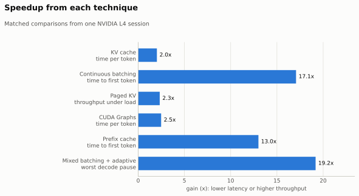
</picture>

<details>
<summary>Workloads for this table</summary>

- **KV cache, CUDA Graphs:** one request with a 512-token prompt. The CUDA Graphs row is the single-request decode engine; graphs also run inside the serving engine (see [CUDA Graphs in the serving engine](#cuda-graphs-in-the-serving-engine)).
- **Continuous batching, paged KV:** 16 requests (128–1,024-token prompts) arriving every 150 ms; every policy may run all 16 at once.
- **Prefix cache:** 8 requests sharing a 2,048-token system prompt.
- **Mixed batching:** 6 requests alternating 128- and 6,144-token prompts while earlier ones decode. Worst pause = the median over runs of each run's longest gap between two tokens.

</details>

<details>
<summary>How each technique works</summary>

- **KV cache:** keeps each layer's keys and values, so a new token attends to the cached history instead of re-running the whole prompt.
- **Continuous batching:** adds new requests between decode steps and removes finished ones at once, instead of waiting for a whole batch to finish. With paged KV, a request waits only when KV memory is actually full.
- **Paged KV:** stores the KV cache in fixed 16-token pages with a page table per request (like virtual memory), read by a Triton paged-attention kernel. Requests can join and leave without copying caches. Several prompts are prefilled together in one flat batch (no padding).
- **CUDA Graphs:** decode was limited by the CPU launching about 2,000 small kernels per token (GPU only ~40% busy). Replaying a captured graph removes that cost (GPU ~90% busy). One graph per batch-size bucket (1/2/4/8/16/32); padding rows write only to their own scratch page.
- **Prefix cache:** identical prompt prefixes share read-only KV pages, with reference counts and LRU eviction.
- **Mixed batching + adaptive chunks:** explained in detail in [Chunked prefill](#chunked-prefill-keeping-decode-smooth) below.

</details>

## Chunked prefill: keeping decode smooth

### The problem

When a long prompt arrives, standard prefill reads all of it in one pass. That pass takes 1.4 s for 8k tokens and 3.4 s for 16k. During it, **every user who is already generating gets no tokens at all**: their text stops, then jumps.

### The fix

Cut the long prompt into chunks, and give every step a mix of work:

```
Standard:  [decode][decode][═══════ long prompt, 1.4 s ═══════][decode][decode]
                                  nobody gets a token

Chunked:   [decode][decode][decode + chunk][decode + chunk][decode + chunk]...[decode]
                            every step still gives each user one token
```

1. **Every step carries one token for each user who is decoding,** plus one chunk of the long prompt.
2. **The long prompt moves forward one chunk per step,** and its KV cache fills page by page.
3. **Chunk sizes are adaptive.** A small planner measures how long steps take and picks each chunk so the step lasts about **150 ms** when others are decoding (**400 ms** when the GPU is idle). Later chunks are smaller, because they attend to more earlier tokens.
4. **The output is exactly the same.** Chunked, mixed and whole-prompt prefill all produce bit-identical tokens (checked by `scripts/check_policy_equivalence.py`).

### What it does: one long prompt arrives

8 users are generating; then one long prompt arrives. While it is read, **9 requests are active: 8 decoding + 1 prefilling**. Three policies on the same traffic:

<picture>
  <source media="(prefers-color-scheme: dark)" srcset="assets/chunked_vs_standard/chunked-timeline-dark.svg">
  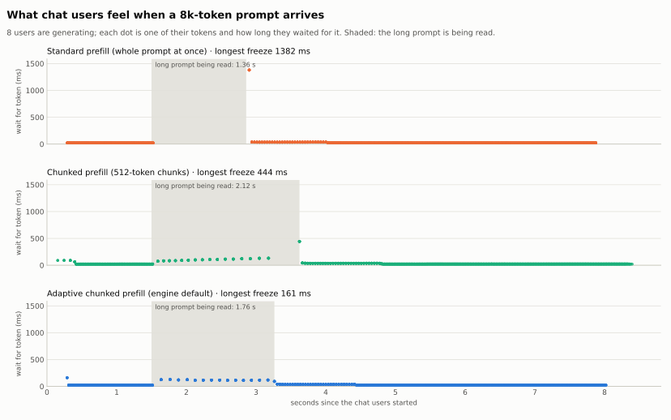
</picture>

| Long prompt | | Standard | Chunked (512 tokens) | **Adaptive (default)** |
|---|---|---|---|---|
| 8k tokens | Users' longest freeze | 1,382 ms | 444 ms | **161 ms** |
| | Users' decode speed while it is read | 2% of normal | 19% | **21%** |
| | Long prompt's first token | **1.36 s** | 2.12 s | 1.76 s |
| 16k tokens | Users' longest freeze | 3,426 ms | 218 ms | **159 ms** |
| | Users' decode speed while it is read | 1% of normal | 17% | **19%** |
| | Long prompt's first token | **3.37 s** | 4.64 s | 5.73 s |

What each step carried (8k prompt):

| Policy | Steps with prompt work | Prompt tokens per step | Decode tokens per step |
|---|---|---|---|
| Standard | 1 | 8,192 | 0 (decode waits) |
| Chunked (512 tokens) | 17 | 504 (last one 128) | 8 |
| Adaptive | 15 | 912 at first, down to 192 | 8 |

- **The freeze disappears.** With adaptive chunks, the worst wait stays near 160 ms at any prompt size.
- **Decode slows but never stops:** about 7–9 tokens/s per user, still readable as streaming text, instead of zero.
- **The long prompt pays for it:** its first token comes 28–70% later, because it shares every step.

### What it does: real-world traffic

40 requests at random times (1.5 per second); prompts 60% short (128–1k tokens), 30% medium (1k–4k), 10% long (8k–16k); KV cache sized to free GPU memory. One measured run per policy.

On average **about 16 requests were decoding** at once (26–30 at the busiest moment), and about 1 was waiting for its first token (up to 7 with standard prefill).

<picture>
  <source media="(prefers-color-scheme: dark)" srcset="assets/chunked_vs_standard/chunked-mixed-summary-dark.svg">
  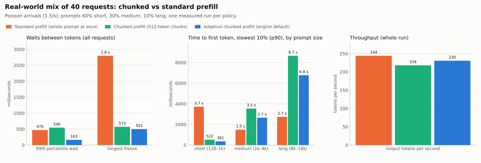
</picture>

| | Standard | Chunked (512 tokens) | **Adaptive (default)** |
|---|---|---|---|
| Longest freeze | 2.8 s | 573 ms | **501 ms** |
| Waits between tokens over 1 s | 41 | 0 | **0** |
| 99% of waits are under | 470 ms | 546 ms | **163 ms** |
| Short prompts, slowest 10%: first token | 3.7 s | 522 ms | **361 ms** |
| Throughput | **244 tok/s** | 218 tok/s | 230 tok/s |

- **Short prompts no longer get stuck behind long ones.** With standard prefill, a short chat arriving during a long prompt waited up to 3.7 s for its first token; with adaptive chunks, at most 0.36 s.
- **The cost is about 6% throughput,** because steps that carry a chunk run without CUDA graphs.

### When to use which

| Situation | Use |
|---|---|
| Many users chatting; smooth streaming matters | **adaptive chunked prefill** (the default) |
| One user at a time, or offline batch jobs | standard prefill: fastest first token, least total work |
| Very long prompts and you want their first token sooner | fixed chunks, but avoid a tiny last chunk (≤128 tokens) |

The last row comes from something this study found. To stay bit-identical, a chunk of 128 tokens or fewer is padded to the full prompt length. So a tiny last chunk (5 tokens of a 9k prompt in one run) costs a 0.5 s step for everyone. The adaptive planner never leaves such a chunk.

Full study: [chunked vs standard prefill](phase_notes/chunked_vs_standard.md). Design and exactness details: [chunked prefill notes](phase_notes/chunked_prefill.md).

## CUDA Graphs in the serving engine

Separate L4 run (1 warm-up + 3 measured runs, zero allocator retries) comparing
eager and graph decode inside the continuous/mixed scheduler. Graph and eager
policies emit identical tokens (72/72 request outputs across 9 policies).

<picture>
  <source media="(prefers-color-scheme: dark)" srcset="assets/cuda_graphs/decode-tpot-dark.svg">
  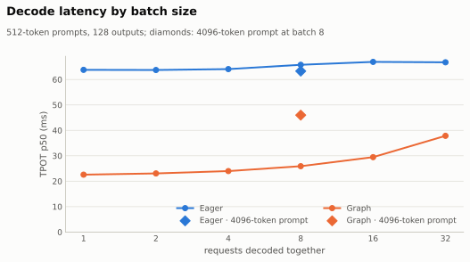
</picture>

| | Eager | CUDA Graph | Gain |
|---|---|---|---|
| Decode, 1 request (time per token) | 63.8 ms | 22.6 ms | **2.8x** |
| Decode, 32 requests (time per token) | 66.8 ms | 37.8 ms | **1.8x** |
| Serving 16 arriving requests (time per token) | 68.2 ms | 34.7 ms | **2.0x** |
| Serving 16 arriving requests (output tok/s) | 196.9 | 341.6 | **1.7x** |
| Long prompts arriving constantly, mixed + adaptive (output tok/s) | 39.2 | 49.8 | **1.3x** |
| Prefill, 8192 tokens (time to first token) | 2,170 ms | 2,168 ms | none |

Graphs speed up decode only. Prefill is not graphed and already keeps the GPU
busy, and iterations that carry prompt chunks stay eager, so the gain shrinks
when long prompts arrive constantly. Each batch-size bucket costs about 0.27 s
to capture once and ~22 MiB of graph memory. Details:
[CUDA Graphs notes](phase_notes/cuda_graphs.md).

## Fused kernels

Between the FP8 matmuls, each layer ran dozens of small PyTorch ops (RMSNorm's casts,
square, mean and scaling; SiLU and the gate multiply; RoPE's slices, negation and
concatenation), each reading and writing a full activation tensor. Four fused Triton
kernels (RMSNorm, residual add + RMSNorm, SiLU x up, RoPE) do each in one pass. They are
bit-identical to the PyTorch ops, including PyTorch's reduction order inside RMSNorm, so
tokens do not change (112/112 request outputs identical across eager, chunked, adaptive,
and CUDA Graph policies). Separate L4 run, zero allocator retries:

<picture>
  <source media="(prefers-color-scheme: dark)" srcset="assets/fused_kernels/prefill-ttft-dark.svg">
  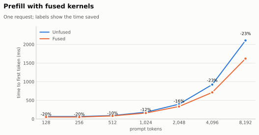
</picture>

| | Unfused | Fused | Change |
|---|---|---|---|
| Prefill, 2,048 tokens | 396.8 ms | 334.0 ms | **-16%** |
| Prefill, 8,192 tokens | 2,104.5 ms | 1,618.2 ms | **-23%** |
| Decode, 1 request, eager (time per token) | 62.5 ms | 50.2 ms | **-20%** |
| Decode, 1 request, CUDA Graph (time per token) | 22.6 ms | 20.7 ms | -8% |
| Serving 16 requests with CUDA Graphs (output tok/s) | 339.7 | 357.9 | +5% |
| q-head RMSNorm alone, 2,048 tokens | 0.783 ms | 0.098 ms | 8.0x faster |

Details: [fused kernels notes](phase_notes/fused_kernels.md).

## Merged projections

Each layer used to run q, k and v as three FP8 matmuls, and gate and up as two. Small matmuls (k and v have only 1,024 outputs) use the GPU poorly. Now q/k/v run as **one** matmul and gate/up as **one**. Results are bit-identical, because the split points line up with the kernel's 128-wide blocks.

| | Change |
|---|---|
| Eager decode (time per token) | **−11 to −17%** |
| CUDA Graph decode, 32 requests (output tok/s) | 605 → 626 (+3%) |
| Short prefill | −13% |

Details: [GEMM peak and merged projections](phase_notes/gemm_peak.md).

## A FlashAttention-style prefill kernel

Naive attention writes a score table with one number per pair of tokens to memory: 6 GB at 4k tokens, and it runs out of memory at 8k. FlashAttention never writes that table: it works on small tiles in fast on-chip memory, with a running softmax. We wrote our own tiled kernel in Triton that reads straight from the paged KV cache.

<picture>
  <source media="(prefers-color-scheme: dark)" srcset="assets/attention/attention-prefill-dark.svg">
  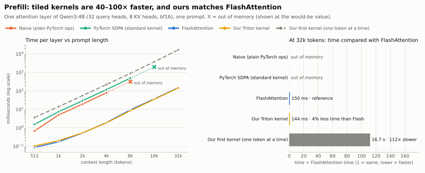
</picture>

- **One prompt:** the same speed as PyTorch's FlashAttention from 4k to 16k tokens, 4–5% faster at 32k, 8–16% slower below 2k.
- **Many prompts at once:** 9–39% less time than the engine's one-call-per-prompt loop, because all prompts go in one launch. FlashAttention's own one-launch (varlen) kernel gets the same gain; we tie it.
- **End to end:** time to first token 4–10% lower.

What made it fast:
- **Query tiles on tensor cores:** each K/V tile serves a whole block of queries.
- **Grouped-query packing:** the 4 query heads that share one KV head run in one program.
- **K read in its page layout,** and masking only on diagonal tiles.

It rounds slightly differently from PyTorch, so it is opt-in (`packed_attention_backend="triton_flash"`). Our first version handled one query token at a time and was 110× slower; the note explains why tiling fixes that. Details: [attention comparison](phase_notes/attention_compare.md).

## What we measured

Each study answers one question about inference on this GPU. The full list is in [inference_questions.md](inference_questions.md).

| Question | Answer in one line | Study |
|---|---|---|
| How fast can the L4 really compute? | The 72 W cap lowers the clock: FP8 peaks at about 127 TFLOPS measured vs 242 on the datasheet; our FP8 kernel reaches about 80% of cuBLAS. | [GEMM peak](phase_notes/gemm_peak.md) |
| Where does a decode step's time go? | Without CUDA graphs, about half is the CPU launching kernels; reading the weights takes about 18.5 ms per step. | [Decode breakdown](phase_notes/decode_breakdown.md) |
| Is prefill compute-bound and decode memory-bound? | Yes. Decode does 2–13 FLOPs per byte (far below the GPU's balance point); prefill is compute-bound from about 300 tokens. | [Roofline](phase_notes/roofline.md) |
| What happens before the first token? | Alone, reading the prompt is over 99% of the wait (44 ms–1.4 s). In bursts, the wait is mostly other people's prompts: about (tokens ahead) ÷ 6,500 per second. | [TTFT anatomy](phase_notes/ttft_anatomy.md) |
| How big should one prefill pass be? | Full speed (about 8,500 tokens/s) from 1k–2k tokens; bigger passes aren't faster. The 16k cap is a safety limit. | [Prefill pass size](phase_notes/prefill_pass_size.md) |
| Why is FlashAttention faster with the same math? | It never writes the N×N score table: 40–115× faster than naive, and tiny memory. Our tiled kernel matches it. | [Attention](phase_notes/attention_compare.md) |
| What does chunked prefill do for users who are decoding? | Removes freezes (3.4 s → 0.16 s) and keeps short prompts fast in mixed traffic, for about 6% throughput. | [Chunked vs standard](phase_notes/chunked_vs_standard.md) |
| How close are we to vLLM? | Equal for single-request decode and steady short-request serving; 17% lower throughput at 32+ requests and 22% lower with long prompts mixed in, but smaller worst pauses (160 vs 369 ms). | [vLLM comparison](phase_notes/vllm_comparison.md) |

## Correctness

- **Checked against Hugging Face:** every engine was compared token for token with Hugging Face `generate()` on the validation workloads. The one documented exception is an exact BF16 logit tie in the prefix-cache reference.
- **All scheduling policies agree:** whole-prompt, chunked, flattened, mixed, adaptive and their CUDA Graph versions produce bit-identical tokens.
- **Our kernels round where PyTorch rounds:** the fused kernels and merged projections are bit-identical too.
- **The opt-in `triton_flash` attention kernel is the exception:** it rounds slightly differently, so it is off by default.
- **Batch shape can matter:** on long batched outputs, batch shape alone can flip a near-tied token; Hugging Face `generate()` does the same.

<details>
<summary>Detailed benchmarks</summary>

<picture>
  <source media="(prefers-color-scheme: dark)" srcset="assets/showcase/decode-engines-dark.svg">
  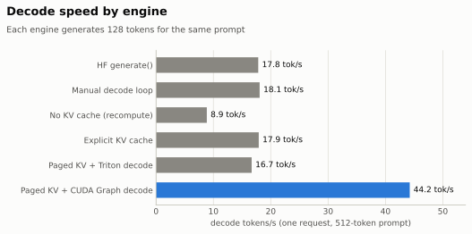
</picture>

**Decode engines** (one request, 512-token prompt, 128 output tokens)

| Engine | Time to first token | Time per output token | Decode tok/s | GPU busy |
|---|---|---|---|---|
| HF `generate()` | 89 ms | 56.1 ms | 17.8 | 43% |
| Manual decode loop | 88 ms | 55.4 ms | 18.1 | 44% |
| No KV cache (recompute) | 88 ms | 113.0 ms | 8.8 | 99% |
| Explicit KV cache | 88 ms | 55.9 ms | 17.9 | 44% |
| Paged KV + Triton decode | 102 ms | 60.0 ms | 16.7 | 40% |
| Paged KV + CUDA Graph decode | 90 ms | **22.6 ms** | **44.2** | 100% |

Decode tok/s is 1,000 / time per output token. GPU busy is the median of NVML utilization
sampled every 0.25 s during each run (about 30 samples per run).

<picture>
  <source media="(prefers-color-scheme: dark)" srcset="assets/showcase/batch-scaling-dark.svg">
  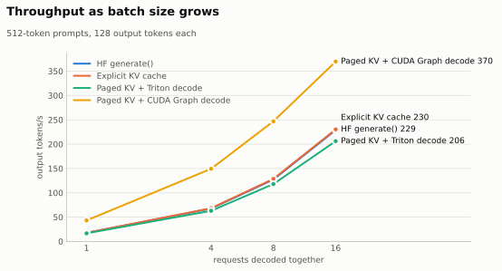
</picture>

**Throughput by batch size** (output tok/s end to end, including prefill;
512-token prompts, 128 outputs)

| Engine | 1 | 4 | 8 | 16 |
|---|---|---|---|---|
| HF `generate()` | 17.7 | 67.6 | 127.3 | 228.9 |
| Explicit KV cache | 17.7 | 68.3 | 128.7 | 230.3 |
| Paged KV + Triton decode | 16.7 | 63.0 | 118.0 | 206.1 |
| Paged KV + CUDA Graph decode | **43.3** | **149.4** | **246.9** | **369.8** |

<picture>
  <source media="(prefers-color-scheme: dark)" srcset="assets/showcase/serving-dark.svg">
  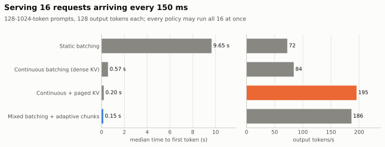
</picture>

**Serving** (16 requests, 128-1024-token prompts, one every 150 ms, 128
outputs; every policy may run all 16 at once)

| Policy | TTFT median / P95 | Time per output token | Worst pause (median of runs) | Output tok/s | Peak memory |
|---|---|---|---|---|---|
| Static batching | 9.65 / 10.72 s | 136.7 ms | 143 ms | 72.4 | 7.4 GiB |
| Continuous batching (dense KV) | 0.57 / 1.51 s | 176.4 ms | 1,399 ms | 83.9 | 10.8 GiB |
| Continuous + paged KV | 0.20 / **0.37 s** | **68.9 ms** | 283 ms | **195.4** | 5.6 GiB |
| Mixed batching + adaptive chunks | **0.15** / 0.41 s | 70.3 ms | **151 ms** | 186.4 | **5.5 GiB** |

<picture>
  <source media="(prefers-color-scheme: dark)" srcset="assets/showcase/long-prompts-dark.svg">
  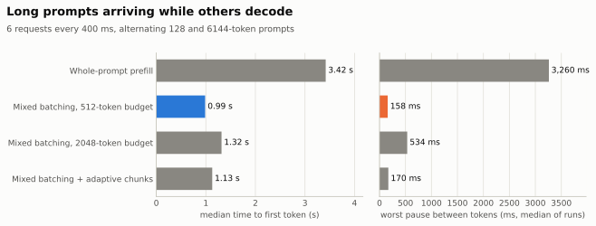
</picture>

**Long prompts while decoding** (6 requests, 128/6144-token prompts, one every
400 ms, 64 outputs; worst pause = median over runs of each run's longest gap)

| Policy | TTFT median / P95 | Worst pause | Output tok/s |
|---|---|---|---|
| Whole-prompt prefill | 3.42 / 4.42 s | 3,260 ms | 41.7 |
| Mixed batching, 512-token budget | **0.99** / 3.42 s | **158 ms** | 39.6 |
| Mixed batching, 2048-token budget | 1.32 / **2.91 s** | 534 ms | **41.8** |
| Mixed batching + adaptive chunks | 1.13 / 3.48 s | 170 ms | 39.7 |

<picture>
  <source media="(prefers-color-scheme: dark)" srcset="assets/showcase/prefix-cache-dark.svg">
  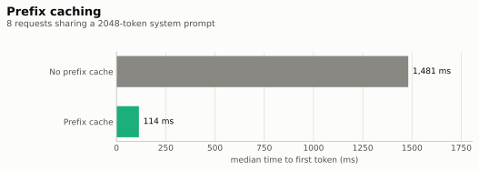
</picture>

**Prefix cache** (8 requests sharing a 2048-token system prompt, 64-token user
turns, one every 300 ms)

| | TTFT median / P95 | Output tok/s |
|---|---|---|
| Off | 1,481 / 2,246 ms | 64.5 |
| On | **114 / 424 ms** | **83.3** |

<picture>
  <source media="(prefers-color-scheme: dark)" srcset="assets/showcase/prefill-ttft-dark.svg">
  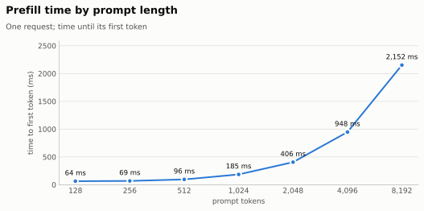
</picture>

**Prefill** (one request, time to first token)

| Prompt tokens | 128 | 256 | 512 | 1024 | 2048 | 4096 | 8192 |
|---|---|---|---|---|---|---|---|
| TTFT (ms) | 64 | 69 | 96 | 185 | 406 | 948 | 2,152 |

Deeper studies (prompt lengths 128-8192 with batch sizes 1-16, decode
interference per arriving prompt, chunk-size sweeps) are in
[archive/](archive/README.md).

</details>

## Reproduce

Run from the repository root that contains `minillm_l4/`:

```bash
# All headline benchmarks (about 30 minutes on an L4)
.conda-env/bin/python -m minillm_l4.benchmarks.commands.run_showcase \
    --output-dir minillm_l4/results/showcase_$(date +%Y%m%d)

# README charts (light and dark SVG)
.conda-env/bin/python minillm_l4/benchmarks/charts/make_showcase_charts.py \
    minillm_l4/results/showcase_<date>/showcase.json minillm_l4/assets/showcase

# Eager vs CUDA Graph comparison, and its charts
.conda-env/bin/python -m minillm_l4.benchmarks.commands.run_cuda_graphs \
    --output-dir minillm_l4/results/cuda_graphs_$(date +%Y%m%d)
.conda-env/bin/python minillm_l4/benchmarks/charts/make_cuda_graph_charts.py \
    minillm_l4/results/cuda_graphs_<date>/cuda_graphs.json minillm_l4/assets/cuda_graphs

# Unfused vs fused kernels (per op and end to end)
.conda-env/bin/python -m minillm_l4.benchmarks.commands.run_fused_kernels \
    --output-dir minillm_l4/results/fused_kernels_$(date +%Y%m%d)

# Chunked vs standard prefill (one long prompt; real-world mix) and their charts
.conda-env/bin/python -m minillm_l4.benchmarks.commands.run_chunked_vs_standard \
    --output-dir minillm_l4/results/chunked_vs_standard_$(date +%Y%m%d)
.conda-env/bin/python -m minillm_l4.benchmarks.commands.run_chunked_vs_standard --workload mixed \
    --output-dir minillm_l4/results/chunked_vs_standard_mixed_$(date +%Y%m%d)
.conda-env/bin/python minillm_l4/benchmarks/charts/make_chunked_vs_standard_charts.py \
    minillm_l4/results/chunked_vs_standard_<date>/chunked_vs_standard.json minillm_l4/assets/chunked_vs_standard

# Attention: naive vs SDPA vs FlashAttention vs our kernels
.conda-env/bin/python -m minillm_l4.benchmarks.commands.run_attention_compare \
    --output-dir minillm_l4/results/attention_compare_$(date +%Y%m%d)

# Watch the engine stream tokens with live TTFT / TPOT
.conda-env/bin/python minillm_l4/scripts/stream_generate.py \
    --prompt-length 128 6144 --max-new-tokens 64 --batch-size 6 \
    --arrival-interval-ms 400 --adaptive

# Tests
.conda-env/bin/python -m pytest -q minillm_l4/tests
```

The full command reference and directory layout are in
[commands.md](commands.md).
