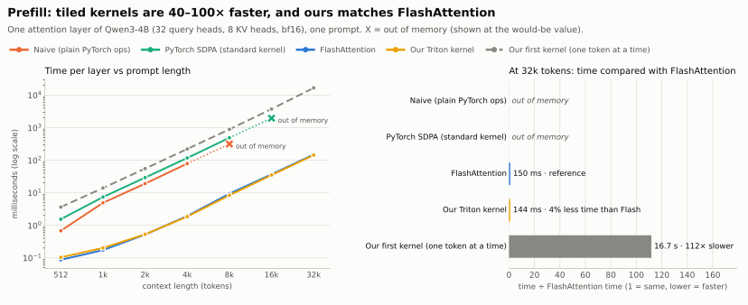
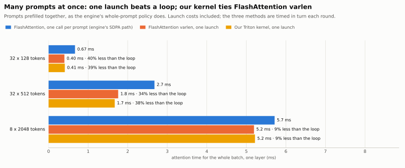
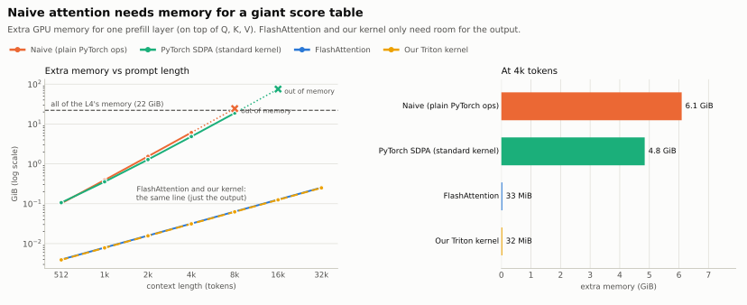
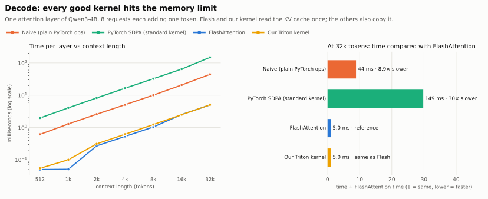

# Q6: Why is FlashAttention faster when the math is the same?

All methods below compute the same thing: `softmax(Q·Kᵀ / √d) · V`. The outputs match (see the last section). The difference is **how often the data travels between GPU memory and the compute units**.

| Method | What it is |
|---|---|
| **Naive** | Plain PyTorch ops, as in Transformers' "eager" attention: Q·Kᵀ, mask, softmax, ·V |
| **PyTorch SDPA** | `scaled_dot_product_attention` with its standard (math) kernel |
| **FlashAttention** | the same SDPA call with its FlashAttention kernel (the engine's default prefill) |
| **Our Triton kernel** | prefill: our tiled kernel over the paged KV cache (`triton_flash_prefill.py`); decode: our paged decode kernel |
| *Our first kernel* | our first prefill kernel: one query token at a time (gray dashed line in the charts) |

## The short answer

- **Naive and standard SDPA write a giant score table to memory.** It has one number for every pair of tokens, for every head: 6.1 GB at 4k tokens, 4× more each time the prompt doubles. Naive runs out of memory at 8k, standard SDPA at 16k.
- **FlashAttention never writes the table.** It works on small tiles in fast on-chip memory and keeps a running softmax. It needs only room for the output, and the GPU spends its time on math.
- **Our Triton kernel uses the same tricks and matches FlashAttention:**
  - one long prompt: the same speed from 4k to 16k tokens and **4–5% less time at 32k**; 8–16% slower below 2k;
  - many prompts at once (how the engine prefills): **9–39% less time than the engine's one-call-per-prompt loop**, because we handle all prompts in one launch. FlashAttention's own varlen kernel (also one launch) gets the same gain: we tie it (3% slower to 6% faster);
  - end to end in the engine: **time to first token 4–10% lower**.
- **Our first kernel shows why tiling matters.** It skips the score table too (same small memory), but works on one token at a time, so it is about 110× slower than FlashAttention.
- **Decode:** FlashAttention and our kernel are equally fast (5.0 ms at 32k). Naive is 9× and standard SDPA 30× slower, because they copy the whole KV cache first.

## Prefill: speed

<picture>
  <source media="(prefers-color-scheme: dark)" srcset="../assets/attention/attention-prefill-dark.svg">
  
</picture>

One prompt, one layer:

| Prompt length | Naive | PyTorch SDPA | FlashAttention | **Our Triton kernel** | Our first kernel |
|---|---|---|---|---|---|
| 512 | 0.68 ms | 1.5 ms | 0.087 ms | **0.10 ms** | 3.6 ms |
| 2k | 19 ms | 29 ms | 0.52 ms | **0.53 ms** | 55 ms |
| 4k | 79 ms | 117 ms | 1.93 ms | **1.85 ms** | 222 ms |
| 8k | out of memory | 490 ms | 9.4 ms | **8.4 ms** | 0.9 s |
| 32k | out of memory | out of memory | 150 ms | **144 ms** | 16.7 s |

- **FlashAttention and our kernel run at 59–74 TFLOPS,** about the L4's BF16 matrix-multiply limit (about 64 TF under its power cap, see `gemm_peak.md`). Attention becomes as fast as a plain matrix multiply.
- **Naive and standard SDPA run at 1.1–1.8 TFLOPS,** and our first kernel at 0.6. The GPU mostly waits for memory.
- **A stricter test agrees, with smaller margins.** The table times one call at a time. A test that alternates the two kernels under CUDA graphs for 15 rounds (so the power-capped clock affects both equally) gives our time ÷ Flash time:

  | 512 | 1k | 2k | 4k | 8k | 16k | 32k |
  |---|---|---|---|---|---|---|
  | 1.15 | 1.16 | 1.08 | 1.01 | 0.99 | 0.98 | 0.95 |

  So for one prompt: slower below 2k, the same from 4k to 16k, faster at 32k.

## Prefill: many prompts at once

<picture>
  <source media="(prefers-color-scheme: dark)" srcset="../assets/attention/attention-packed-dark.svg">
  
</picture>

The engine prefills waiting prompts together. Its default (SDPA) path then calls FlashAttention **once per prompt**: many small launches, and each one alone is too small to fill the GPU. A **one-launch (varlen) kernel** puts every prompt in one grid, with `cu_seqlens` marking where each prompt starts. We compare both one-launch kernels against the loop: PyTorch's FlashAttention-2 varlen kernel (`torch.nn.attention.varlen.varlen_attn`, the same code as `flash_attn_varlen_func`) and ours.

| Prompts | FlashAttention, one call per prompt | FlashAttention varlen, one launch | **Our Triton kernel, one launch** |
|---|---|---|---|
| 32 × 128 tokens | 0.67 ms | 0.40 ms (−40%) | 0.41 ms (−39%) |
| 32 × 512 tokens | 2.7 ms | 1.8 ms (−34%) | **1.7 ms (−38%)** |
| 8 × 2,048 tokens | 5.7 ms | 5.2 ms (−9%) | 5.2 ms (−9%) |

- **The win over the loop comes from one launch, not from a better kernel.** FlashAttention varlen gets the same gain.
- **Against FlashAttention varlen we tie:** 3% slower at 32 × 128, 6% faster at 32 × 512, equal at 8 × 2,048 (same result in two runs). Ours also reads K/V straight from the paged cache; varlen here reads one contiguous K/V buffer.
- **The gain shrinks for longer prompts,** because one long prompt already fills the GPU by itself.
- Timing: the three methods run in turn each round (21 rounds, median), so GPU clock drift hits all of them equally.

**In the full engine** (whole-prompt policy, all 36 layers, `packed_attention_backend="triton_flash"`), time to first token drops 4–10% on bursts from 32 × 128 to 1 × 16,384 tokens. The gain is smaller than above because the FP8 matrix multiplies take most of the prefill time.

## Prefill: memory

<picture>
  <source media="(prefers-color-scheme: dark)" srcset="../assets/attention/attention-memory-dark.svg">
  
</picture>

| Prompt length | Naive | PyTorch SDPA | FlashAttention | **Our Triton kernel** |
|---|---|---|---|---|
| 512 | 104 MB | 109 MB | 4 MB | **4 MB** |
| 4k | 6.1 GB | 4.8 GB | 33 MB | **32 MB** |
| 8k | out of memory (needs ~24 GB) | 18.8 GB | 65 MB | **64 MB** |
| 32k | out of memory | out of memory | 260 MB | **256 MB** |

- **The score table is the whole problem.** It grows 4× per doubling and hits the L4's 22 GB at about 8k (naive) to 16k (standard SDPA) tokens.
- **FlashAttention and our kernels need only the output,** which grows 2× per doubling.

## The tricks, and how we got from 110× slower to faster than Flash

FlashAttention's two tricks:

1. **Running softmax (no score table).** Softmax needs a row's maximum and sum. Keep a running max and sum and rescale as you go, so the full row is never stored. This saves the **memory**.
2. **Tiles that reuse K and V.** Load a block of queries into on-chip memory and stream K/V past it, so each piece of K/V read from memory serves the whole block. The math runs on tensor cores. This saves the **time**.

Our first kernel had trick 1 only: one query row per program, so it read all of K and V again for every row. At 4k tokens that is about 137 GB of reads vs about 1 GB with tiles, which is why it was about 110× slower.

Our Triton kernel adds trick 2, plus three things that suit this model and the paged cache:

- **GQA packing.** Qwen3-4B has 4 query heads per KV head. One program handles the heads that share a KV head, so each K/V tile loaded from the cache serves 4× more rows. PyTorch's FlashAttention loads it separately for each query head.
- **K read in its page layout** (`[keys, dim]`) and transposed inside the dot product: 4–7% faster than reading it pre-transposed.
- **Only diagonal tiles are masked,** and the heaviest (latest) tiles start first.
- **Two fixed configs**, picked by the alternating test above. Triton's autotuner picked differently on every run, because the clock drifts while it tries configs.

Tried and dropped: pairing early and late tiles, one always-masked loop, folding the scale into Q (less accurate), and FlashAttention-2's fused exponent trick (slower in Triton).

**Why it is still slower below 2k:** each program does little work there, and FlashAttention's hand-written kernel uses the GPU better per program (about 46 vs 40 TFLOPS at 512 tokens). Paging, tile size and load balance were all ruled out.

**Why it is opt-in in the engine:** it rounds slightly differently from PyTorch's FlashAttention. In the end-to-end test, 106 of 108 requests produced the same 32 tokens; in 2, a near-tie between two tokens flipped (at tokens 2 and 25). The engine's correctness gate requires identical tokens, so the default stays SDPA.

## Decode: speed

<picture>
  <source media="(prefers-color-scheme: dark)" srcset="../assets/attention/attention-decode-dark.svg">
  
</picture>

8 requests, each adding one token, one layer:

| Context | Naive | PyTorch SDPA | FlashAttention | **Our Triton kernel (engine)** |
|---|---|---|---|---|
| 512 | 0.61 ms | 2.0 ms | 0.050 ms | **0.055 ms** |
| 2k | 2.6 ms | 8.2 ms | 0.27 ms | **0.31 ms** |
| 8k | 10 ms | 33 ms | 1.0 ms | **1.2 ms** |
| 32k | 44 ms | 149 ms | 5.0 ms | **5.0 ms** |

- **With one new token there is no big table.** Decode just reads the KV cache, so the best time is "KV size ÷ memory speed". At 32k the 8 requests have 1.07 GB of K/V per layer: 5.0 ms means 214 GB/s, close to the L4's real copy speed (about 231 GB/s).
- **Our kernel matches FlashAttention** at long contexts and is within 10–20% at short ones. It reads K/V straight from the paged cache, which SDPA can't.
- **Naive and standard SDPA copy the cache first,** expanding K/V from 8 heads to 32 (standard SDPA also converts to 32-bit). At 32k standard SDPA needs 14 GB of extra memory for one layer.
- **Decode only gets faster with less data.** No kernel beats memory speed; a smaller KV cache (8-bit) would.

## Does the math really match?

Yes. Every output was compared with an FP32 reference:

- **FlashAttention, standard SDPA and our kernels:** max error 0.008 (prefill) and 0.0001–0.001 (decode), the normal rounding of a bf16 result. Our tiled kernel's error equals FlashAttention's at every size.
- **Naive:** max error about 0.02. It rounds the score table to bf16 before softmax, which makes it the *least* accurate.

## Two more kernels in the data

- **PyTorch's memory-efficient SDPA kernel** (prefill only) uses as little memory as Flash but takes about 1.6× its time (3.1 ms at 4k).
- **Our split-KV decode** (8 parts) is about 1.8× slower at batch 8 (9.0 ms at 32k). Splitting helps only when too few requests keep the GPU busy.

## How it was measured

```bash
.conda-env/bin/python -m minillm_l4.benchmarks.commands.run_attention_compare --output-dir minillm_l4/results/attention_compare_<date>
.conda-env/bin/python minillm_l4/scripts/make_attention_charts.py minillm_l4/results/attention_compare_<date>/attention_compare.json minillm_l4/docs/assets/attention
```

- **Setup:** one attention layer at Qwen3-4B shapes (32 query heads, 8 KV heads, head size 128, bf16), random inputs, no model loaded, the whole L4 free (22 GB). NVIDIA L4, PyTorch 2.13, Triton 3.7, 2026-11-01.
- **Timing:** median of 3–7 runs after a warm-up, with CUDA events. Short decode cases repeat the call many times inside each run. The packed section times one whole batch, launch costs included, as the engine runs it, with the three methods interleaved round by round (21 rounds, median); results in `results/attention_varlen_20261101`.
- **Extra memory:** peak GPU memory during the call minus memory in use before it (inputs excluded). In the charts, an X marks out of memory, drawn at the would-be value (4× the previous size).
- **Methods:**
  - The memory-efficient SDPA kernel has no grouped-KV support, so it got K/V already copied to 32 heads (copy not timed).
  - Our decode kernel uses the engine's settings (SDPA-compatible mode, one KV split). Its optional "GQA reuse" variant was 10–25× slower in a side test and is not used by the engine.
- **Kernel tests:** `tests/test_triton_flash_prefill.py` checks the tiled kernel against FP32 for single, packed and mixed-length prompts, chunks over a cached prefix, and shuffled pages.
