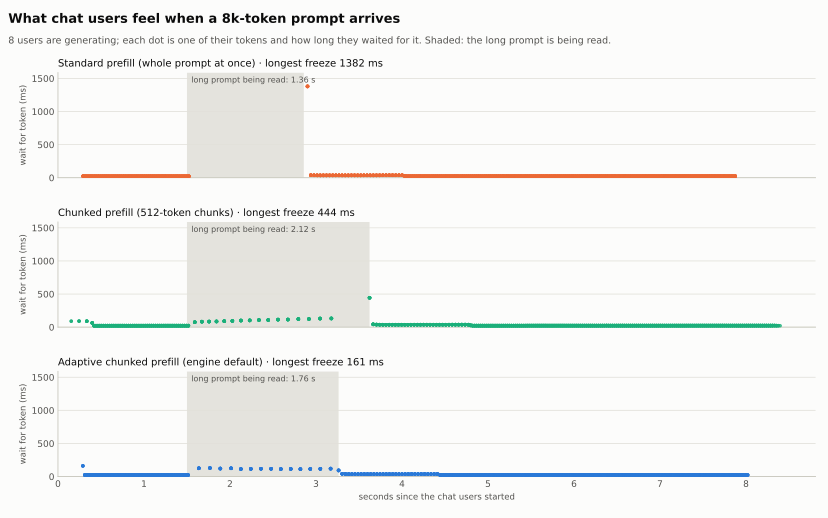
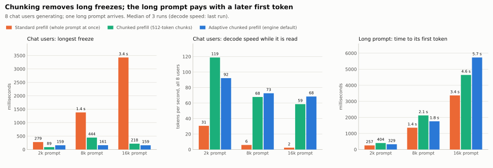
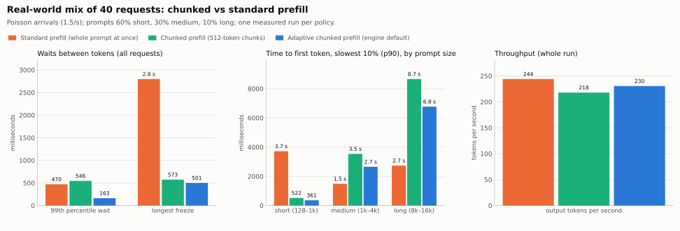

# Chunked prefill vs standard prefill

**The question:** users are chatting (generating tokens) and a long prompt arrives. What happens to the users who are already generating, and what does the long prompt pay?

**The test:** 8 chat users are generating (256-token prompts, 256 new tokens each). After 1.5 s, one long prompt arrives (2k, 8k or 16k tokens). Three policies run the same traffic:

| Policy | What it does |
|---|---|
| **Standard prefill** | reads the whole long prompt in one pass; chat users wait until it is done |
| **Chunked prefill** | every step carries all chat tokens plus up to 512 prompt tokens |
| **Adaptive chunked prefill** | the same, but chunk sizes are picked to keep each step near 150 ms (the engine's default) |

## The short answer

- **Standard prefill freezes everyone.** While the long prompt is read, no chat user gets a token: a 1.4 s freeze for an 8k prompt, 3.4 s for 16k.
- **Chunked prefill keeps chat users moving.** Each step mixes chat tokens with a slice of the long prompt, so the longest freeze drops to about 160 ms (adaptive) at any prompt size. During the 16k prompt, chat users got 392 tokens instead of none.
- **Decode speed while the long prompt is read:** standard drops to 1–8% of normal (practically zero); chunked keeps 17–33% of normal (about 60–120 tokens/s for the 8 users instead of 360).
- **The long prompt pays for it.** Its first token comes 28–70% later (adaptive), because it shares every step with the chat users.
- **Total work grows a little.** Chat users finish 2–12% later, because mixed steps run without CUDA graphs and each chunk re-reads the earlier part of the prompt.
- **In a real-world mix (40 requests, short to 16k prompts),** adaptive chunking cut the longest freeze from 2.8 s to 0.5 s and the slowest short-prompt first token from 3.7 s to 0.36 s, for 6% less throughput.

## What chat users feel

<picture>
  <source media="(prefers-color-scheme: dark)" srcset="../assets/chunked_vs_standard/chunked-timeline-dark.svg">
  
</picture>

Each dot is one chat token, at the time it arrived, and how long the user waited for it. The shaded area is while the 8k prompt is being read.

- **Standard (top):** tokens arrive every 23 ms, then nothing for 1.4 s, then one dot at 1,382 ms. In a chat app, the text stops and then jumps.
- **Chunked (middle):** during the long prompt, tokens keep coming, about every 100–130 ms instead of 23 ms. Text slows down but never stops. One dot at 444 ms is explained below.
- **Adaptive (bottom):** the same, with no spike: the longest wait is 161 ms.

## The numbers

<picture>
  <source media="(prefers-color-scheme: dark)" srcset="../assets/chunked_vs_standard/chunked-summary-dark.svg">
  
</picture>

Median of 3 runs:

| Long prompt | Policy | Chat users: longest freeze | Chat users: p99 wait | Chat tokens while the long prompt is read | Long prompt: first token after | Chat users done at |
|---|---|---|---|---|---|---|
| 2k | Standard | 279 ms | 27 ms | 16 | **257 ms** | **6.41 s** |
| 2k | Chunked 512 | **89 ms** | 83 ms | 48 | 404 ms | 6.59 s |
| 2k | Adaptive | 159 ms | 79 ms | 32 | 329 ms | 6.52 s |
| 8k | Standard | 1,382 ms | 38 ms | 16 | **1.36 s** | **7.87 s** |
| 8k | Chunked 512 | 444 ms | 131 ms | 144 | 2.12 s | 8.40 s |
| 8k | Adaptive | **161 ms** | 121 ms | 128 | 1.76 s | 8.02 s |
| 16k | Standard | 3,426 ms | 51 ms | 16 | **3.37 s** | **10.33 s** |
| 16k | Chunked 512 | 218 ms | 205 ms | 272 | 4.64 s | 11.01 s |
| 16k | Adaptive | **159 ms** | 145 ms | 392 | 5.73 s | 11.59 s |

- **The typical wait doesn't change:** 23 ms per token for all policies, because most steps have no prompt work.
- **The worst wait is what changes.** Standard grows with the prompt (279 ms → 3.4 s). Adaptive stays at about 160 ms whatever the prompt size.
- **"16 chat tokens" with standard** are just the 2 tokens each user got at the edges of the freeze; in between, nothing.

## Decode speed while the long prompt is read

Normal decode speed for the 8 chat users is about **360 tokens/s** (45 per user). While the long prompt is being read:

| Long prompt | Standard | Chunked 512 | Adaptive |
|---|---|---|---|
| 2k | 31 tok/s (8% of normal) | **119 tok/s (33%)** | 92 tok/s (26%) |
| 8k | 6 tok/s (2%) | 68 tok/s (19%) | **73 tok/s (21%)** |
| 16k | 2 tok/s (1%) | 59 tok/s (17%) | **68 tok/s (19%)** |

- **Standard: decode stops.** The few tokens counted are the ones at the very edges of the freeze; per user it is 0.3–3.8 tokens/s.
- **Chunked: decode slows but continues,** at about 7–15 tokens/s per user, still readable as streaming text. A step that carries a prompt slice takes about 100–150 ms instead of 23 ms, which is why the speed falls to about a fifth.
- **Longer prompts lower the speed a bit more,** because later slices attend to more earlier tokens, so each step does more work.

Computed from the last run's token times: chat tokens produced between the long prompt's arrival and its first token, divided by that time. "Normal" is the 0.8 s before the long prompt arrived.

## How chunking helps decode

```
Standard:   [chat][chat][======== long prompt, 1.4 s ========][chat][chat]
                                  nobody gets a token

Chunked:    [chat][chat][chat + slice][chat + slice][chat + slice]...[chat][chat]
                         every step gives each chat user one token
```

1. Every step includes one token for every chat user, so they never wait for the whole prompt.
2. The long prompt advances one slice per step (504 tokens per step with "chunked 512", because the 8 chat tokens share the 512-token budget).
3. A step with a slice is slower than a plain chat step (about 100–150 ms instead of 23 ms). That's the price chat users pay while the long prompt is read.
4. The adaptive planner sizes each slice from measured step times so a step stays near 150 ms. Later slices are smaller, because they attend to more earlier tokens.

## What it costs

- **The long prompt waits longer.** It gets only part of each step:

  | Long prompt | Standard | Adaptive | Extra wait |
  |---|---|---|---|
  | 2k | 257 ms | 329 ms | +28% |
  | 8k | 1.36 s | 1.76 s | +29% |
  | 16k | 3.37 s | 5.73 s | +70% |

- **A little more total work.** Chat users finish 2% (2k, 8k) to 12% (16k) later. Three reasons:
  - steps that carry a slice run eagerly, not as a CUDA graph;
  - each slice's attention re-reads all earlier slices of the prompt;
  - the GPU is busier with many small steps than with one big pass.

## Two things this test found

1. **A tiny last chunk can cause a spike.** With "chunked 512" and an 8k prompt, the last slice was only 128 tokens and took a 444 ms step. To keep outputs bit-identical, the engine handles slices of 128 tokens or fewer by padding them back to the full prompt length. That 128-token slice then cost as much attention as all 8,192 tokens. The adaptive planner never ends on such a small slice (its last was 192), so it has no spike. (At 2k the padding is cheap; at 16k the last slice was 256 tokens, so no padding.)
2. **Adaptive is the smoothest but slowest for very long prompts.** At 16k it kept every step near 150 ms, using 48 small slices instead of 33. Chat users got the most tokens (392) and the smallest freeze (159 ms), but the long prompt's first token came 1.1 s later than with fixed 512-token slices. The planner chooses smoothness for the users already generating.

## Real-world mix

The test above has one long prompt and identical chat users. Real traffic is messier, so this run uses **40 requests arriving at random times** (Poisson, 1.5 per second over 17 s). Prompt sizes are drawn 60% short (128–1k tokens), 30% medium (1k–4k) and 10% long (8k–16k), and each request asks for 64–256 new tokens. The KV cache is sized to the GPU's free memory (87k tokens), as in serving. With seed 7 the draw gave 33 short, 5 medium and 2 long prompts (9k and 16k), 55k prompt tokens in total. One measured run per policy, after a warm-up.

<picture>
  <source media="(prefers-color-scheme: dark)" srcset="../assets/chunked_vs_standard/chunked-mixed-timeline-dark.svg">
  
</picture>

<picture>
  <source media="(prefers-color-scheme: dark)" srcset="../assets/chunked_vs_standard/chunked-mixed-summary-dark.svg">
  
</picture>

| | Standard | Chunked 512 | **Adaptive** |
|---|---|---|---|
| Longest freeze | 2.8 s | 573 ms | **501 ms** |
| Waits over 0.5 s / over 1 s | 67 / 41 | 121 / 0 | **11 / 0** |
| Wait between tokens: median / p99 | **40** / 470 ms | 58 / 546 ms | 53 / **163 ms** |
| First token, short prompts: median / p90 | **133 ms** / 3.7 s | 195 / 522 ms | 145 / **361 ms** |
| First token, medium prompts: median / p90 | **432 ms / 1.5 s** | 661 ms / 3.5 s | 638 ms / 2.7 s |
| First token, the 2 long prompts (median) | **2.7 s** | 8.7 s | 6.8 s |
| Throughput | **244 tok/s** | 218 tok/s | 230 tok/s |

What it shows:

- **Standard freezes everyone twice.** When the 9k and 16k prompts are read, nobody gets a token for 2.8 s and 1.8 s (the two gaps in the top row). 41 token waits exceed 1 second.
- **Short prompts get stuck behind long ones with standard.** The slowest 10% of short prompts waited 3.7 s for their first token, because they arrived while a long prompt was being read. With adaptive chunking they waited at most 0.36 s.
- **Adaptive is the smoothest:** 99% of token waits under 163 ms, only 11 over 0.5 s, none over 1 s.
- **Fixed 512-token chunks had many waits just over 0.5 s.** A rerun showed the cause: the last chunk of the 9k prompt was only 5 tokens. That chunk was padded to the full prompt for exact attention, so the step took 542 ms, and the 25 requests decoding in that step all waited. A few such steps add up to 121 long waits. The adaptive planner doesn't leave tiny last chunks.
- **The costs are the same as in the single-prompt test:**
  - long prompts get their first token later (6.8 s instead of 2.7 s);
  - throughput drops 6% (230 vs 244 tokens/s);
  - the median wait between tokens rises from 40 to 53 ms, because mixed steps run without CUDA graphs.

This is one run of one random trace, so small differences (a few percent) are within noise; the large ones (freezes, short-prompt p90) are not.

## Which to use

- **Many users chatting, smoothness matters:** adaptive chunked prefill (the default). No freezes over about 160 ms with one long prompt, and none over 0.5 s in mixed traffic; short prompts never get stuck behind long ones.
- **One user at a time, or batch jobs:** standard prefill. Fastest first token and least total work.
- **A middle ground:** fixed chunks give a faster first token for very long prompts than adaptive. Avoid ending on a tiny last chunk (≤128 tokens).

## How it was measured

```bash
.conda-env/bin/python -m minillm_l4.benchmarks.commands.run_chunked_vs_standard --output-dir minillm_l4/results/chunked_vs_standard_<date>
.conda-env/bin/python minillm_l4/scripts/make_chunked_vs_standard_charts.py minillm_l4/results/chunked_vs_standard_<date>/chunked_vs_standard.json minillm_l4/docs/assets/chunked_vs_standard
# real-world mix
.conda-env/bin/python -m minillm_l4.benchmarks.commands.run_chunked_vs_standard --workload mixed --output-dir minillm_l4/results/chunked_vs_standard_mixed_<date>
.conda-env/bin/python minillm_l4/scripts/make_chunked_vs_standard_charts.py minillm_l4/results/chunked_vs_standard_mixed_<date>/chunked_vs_standard.json minillm_l4/docs/assets/chunked_vs_standard
```

- **Model and settings:** Qwen3-4B FP8 on one NVIDIA L4, 2026-11-01. CUDA Graph decode, fused kernels and merged projections for every policy; no prefix cache; no HF reference check.
- **Traffic:** 8 chat requests (256-token prompts, 256 new tokens) at t=0, and one long prompt (2k/8k/16k tokens, 32 new tokens) at t=1.5 s.
- **Runs:** one runner per case, used for 1 warm-up run and 3 measured runs. The warm-up captures every CUDA graph batch size, so no capture lands inside a measured run. Tables show the median of 3 runs; the timeline is the last run.
- **Metrics:**
  - "wait" is the time between two tokens of the same chat user;
  - "while the long prompt is read" means from its arrival to its first token;
  - "longest freeze" is the largest wait in the run.
