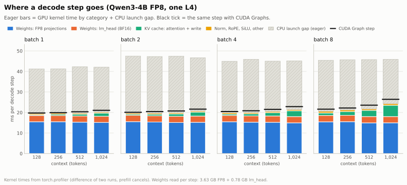
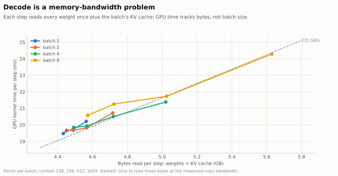
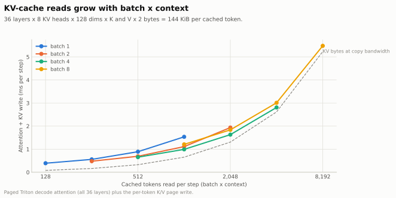

# Where a decode step's time goes

Question: for batch sizes 1–8 and contexts 128–1024 tokens, how much of one decode step goes to each of these?
- reading the weights;
- reading the KV cache;
- other kernels;
- CPU launch overhead.

Command (about 12 minutes):

```bash
.conda-env/bin/python -m minillm_l4.benchmarks.commands.run_decode_breakdown --output-dir minillm_l4/results/decode_breakdown_<date>
.conda-env/bin/python minillm_l4/scripts/make_decode_breakdown_charts.py minillm_l4/results/decode_breakdown_<date>/decode_breakdown.json minillm_l4/docs/assets/decode_breakdown
```

Method:
- **Engine:** Qwen3-4B FP8 on one L4, 2026-10-26. Fused kernels and merged projections are on; continuous batching, no HF reference check.
- **Step time:** TPOT p50 of 64-token decodes, eager and with CUDA Graphs. 1 warm-up and 3 measured runs per case, all unprofiled.
- **GPU time per category:** `torch.profiler` kernel times from two eager runs, (prompt + 1 + 16 tokens) minus (prompt + 1 token), divided by 16. Prefill cancels out exactly.
- **Derived numbers:**
  - CPU launch gap = eager step time − GPU kernel time;
  - per-launch cost = (eager − graph) / kernels per step.
- **Bytes each step must read:**
  - weights: 3.63 GB of FP8 projections plus 0.78 GB of BF16 `lm_head` (tied to the embedding);
  - KV cache: 144 KiB per cached token (36 layers × 8 KV heads × 128 dims × K and V × 2 bytes).

## The breakdown

<picture>
  <source media="(prefers-color-scheme: dark)" srcset="../assets/decode_breakdown/step-breakdown-dark.svg">
  
</picture>

| Batch × context | Eager step | Graph step | GPU kernels | Weights | KV attention | Launch gap (eager) |
|---|---|---|---|---|---|---|
| 1 × 128 | 41.2 ms | 19.8 ms | 19.5 ms | 18.5 ms | 0.33 ms | 21.8 ms (53%) |
| 1 × 1024 | 42.1 | 21.1 | 20.2 | 18.2 | 1.48 | 21.9 (52%) |
| 4 × 512 | 45.0 | 21.5 | 20.5 | 18.3 | 1.58 | 24.5 (54%) |
| 8 × 128 | 45.4 | 21.6 | 20.6 | 18.6 | 1.16 | 24.9 (55%) |
| 8 × 1024 | 45.9 | 26.4 | 24.3 | 18.0 | 5.42 | 21.6 (47%) |

1. **Eager decode is half CPU.** Each step launches about 571–585 kernels, and each costs about 33–48 µs of host time. That covers Python dispatch, argument checks and the launch itself, not only the CUDA driver call. Together they add 22–28 ms per step regardless of batch or context. CUDA Graphs remove nearly all of it: the remaining gap is 0.3–2 ms.
2. **Reading the weights is the step.** At batch 1–8 and context ≤ 1024, the weight GEMMs take 18.0–18.6 ms of the 19.5–24.3 ms GPU time (75–95%). The rate is 237–245 GB/s, at or slightly above the measured 231 GB/s copy bandwidth (a copy also writes; GEMMs only read). Weight time does not grow with batch size: one read of the weights serves every row in the batch. That is why batching decode is nearly free here.
3. **`lm_head` alone is 3.0 ms (15%).** The tied BF16 vocabulary matrix (151,936 × 2,560) is 0.78 GB, as large as 8 FP8 decoder layers. An FP8 copy of `lm_head` would save about 1.5 ms per step. It would change logits slightly, so it needs an accuracy check, not the exactness gate.
4. **KV-cache reads grow with batch × context** and matter only at the larger end: 0.3 ms at 128 cached tokens, 5.4 ms at 8,192 (22% of the GPU step). Small batches use the attention kernel poorly: batch 1 reaches 60–100 GB/s, because one sequence gives too little parallel work. Batches of 4–8 with 512+ tokens reach 200–224 GB/s, close to the bandwidth floor.
5. **Everything else is small:** norm, RoPE and SiLU take 0.4–0.7 ms, and the KV write, embedding, adds and sampling about 0.15 ms.

## Decode is bandwidth-bound

<picture>
  <source media="(prefers-color-scheme: dark)" srcset="../assets/decode_breakdown/bytes-vs-time-dark.svg">
  
</picture>

GPU time per step follows bytes read (weights plus KV cache) along the 231 GB/s line, whatever the batch size. A graph-mode step at batch 1 (19.8 ms) is within 4% of the time needed just to read the weights once.

## KV-cache reads

<picture>
  <source media="(prefers-color-scheme: dark)" srcset="../assets/decode_breakdown/kv-attention-dark.svg">
  
</picture>

## What this means

- **Where the latency is:**
  - eager: CPU launch overhead (about 50%), then weight reads;
  - CUDA Graphs: weight reads (75–95% of GPU time), then the KV cache as batch × context grows.
- **What can still help:**
  - fewer weight bytes (FP8 `lm_head`, or 4-bit weights);
  - a better small-batch attention kernel (more split-K parallelism at batch 1–2);
  - larger batches (weights are read once per step, however many rows share it).
- **What cannot help much:** faster GEMM math. Decode GEMMs already read at copy bandwidth.

Caveats:
- The graph step is 0.3–2.1 ms longer than the eager GPU kernel time. The gap grows with batch × context. Graph decode pads to the bucket size and sizes attention splits for the bucket, so its kernels do slightly more work than eager's.
- Kernel categories come from kernel names. cuBLAS kernels in a decode step are counted as `lm_head`.
