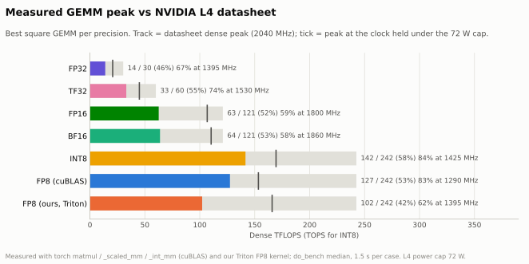
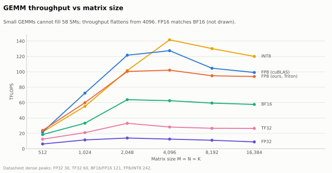
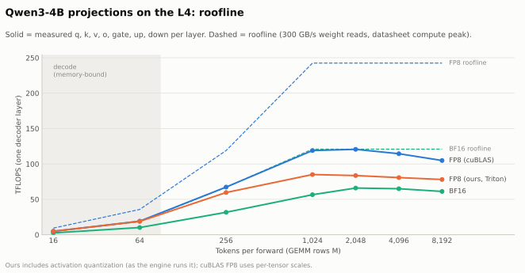

# GEMM peak vs the NVIDIA L4 datasheet

Question: how much of the L4's advertised compute and bandwidth can we actually get, in each precision, and where do Qwen3-4B's projections sit on the roofline?

Command (about 8 minutes, no model download):

```bash
.conda-env/bin/python -m minillm_l4.benchmarks.commands.run_gemm_peak --output-dir minillm_l4/results/gemm_peak_<date>
.conda-env/bin/python minillm_l4/scripts/make_gemm_peak_charts.py minillm_l4/results/gemm_peak_<date>/gemm_peak.json minillm_l4/docs/assets/gemm_peak
```

Setup:
- **Run:** NVIDIA L4, driver 580.178.04, torch 2.13 (cu130), Triton 3.7.1, 2026-10-26.
- **Timing:** `triton.testing.do_bench` median over a 1.5 s window per case, with L2 flushed between runs.
- **Telemetry:** NVML is sampled every 20 ms during each case (SM clock, power, temperature, clock-limit reasons).
- **Baseline:** the datasheet dense peaks (sparse figures ÷ 2) at the 2040 MHz boost clock:

  | Precision | Dense peak |
  |---|---|
  | FP32 | 30.3 TFLOPS |
  | TF32 | 60 TFLOPS |
  | FP16 / BF16 | 121 TFLOPS |
  | FP8 / INT8 | 242.5 TFLOPS (TOPS for INT8) |
  | Memory bandwidth | 300 GB/s |

## Best square GEMM per precision

<picture>
  <source media="(prefers-color-scheme: dark)" srcset="../assets/gemm_peak/peak-vs-datasheet-dark.svg">
  
</picture>

| Precision | Best TFLOPS | Size | % of datasheet | Median SM clock | % of peak at that clock |
|---|---|---|---|---|---|
| FP32 | 13.9 | 2048 | 46% | 1395 MHz | 67% |
| TF32 | 33.1 | 2048 | 55% | 1530 MHz | 74% |
| FP16 | 62.6 | 2048 | 52% | 1800 MHz | 59% |
| BF16 | 63.8 | 2048 | 53% | 1860 MHz | 58% |
| INT8 (cuBLAS `_int_mm`) | 141.6 | 4096 | 58% | 1425 MHz | 84% |
| FP8 (cuBLASLt `_scaled_mm`, per-tensor) | 127.5 | 4096 | 53% | 1290 MHz | 83% |
| FP8 (ours, Triton, 128×128 block scales) | 102.1 | 4096 | 42% | 1395 MHz | 62% |
| Copy bandwidth | 231 GB/s | 1 GiB | 77% | n/a | n/a |

Findings:

1. **The 72 W power cap, not the kernels, is the main gap to the datasheet.** Once a GEMM is large enough to fill the GPU, the card sits at 72 W with `sw_power_cap` active in 100% of samples. The SM clock then falls from 2040 MHz to 900–1400 MHz.
   - At the clock it actually holds, tensor-core cuBLAS GEMMs of 4096 and up reach 83–99% of peak (FP32 CUDA cores: 72–80%). For example, BF16 at 16384 runs at 57.6 TFLOPS at 1005 MHz, which is 97%.
   - The datasheet numbers assume 2040 MHz, which the L4 sustains only on small GEMMs. Small GEMMs are too small to fill 58 SMs.
2. **Throughput falls past 4096.** Bigger matrices draw more power per clock, so the clock drops further. FP8 at 16384 runs at 885 MHz.
3. **FP8 is about 2× BF16, and INT8 is slightly faster than FP8 at large sizes**, because INT8 holds a higher clock at the same power.
4. **FP16 and BF16 run at the same rate.** FP16 with FP32 accumulation runs at full rate on the L4, unlike GeForce Ada cards.
5. **Our FP8 kernel reaches 80% of cuBLAS** at large sizes (102 vs 127 TFLOPS). It does more work: per-128-block scales (needed for the checkpoint's numerics) versus cuBLAS's single per-tensor scale. cuBLAS's per-tensor path cannot run this checkpoint exactly, so it is a ceiling, not a drop-in alternative.
6. **Memory copy reaches 231 GB/s, or 77% of 300 GB/s.** This is the practical ceiling for memory-bound work such as decode.

## Throughput vs size

<picture>
  <source media="(prefers-color-scheme: dark)" srcset="../assets/gemm_peak/size-sweep-dark.svg">
  
</picture>

## Qwen3-4B projections on the roofline

The chart below shows one decoder layer's seven projections (q, k, v, o, gate, up, down) at real shapes, against tokens per forward. Our line is the engine's full FP8 linear, including activation quantization.

<picture>
  <source media="(prefers-color-scheme: dark)" srcset="../assets/gemm_peak/model-roofline-dark.svg">
  
</picture>

- **Decode (M ≤ 64) is memory-bound.** All three implementations sit on the bandwidth slope. FP8 weights halve the bytes read, so FP8 decode GEMMs run about 2× faster than BF16 (5.0 vs 2.7 TFLOPS at M=16).
- **Prefill (M ≥ 1024) is compute-bound, and the power cap sets the ceiling.**
  - cuBLAS FP8 levels off near 120 TFLOPS.
  - Ours reaches 85 TFLOPS at M=1024 and 78 TFLOPS at M=8192.
  - BF16 levels off near 65 TFLOPS.
- **The k/v projections (N=1024) are our weakest shape.** Ours reaches 51 TFLOPS at M=2048, versus 101 for cuBLAS: a narrow N gives too few tiles to fill 58 SMs. Merged projections (below) address this.

## Merged projections

`engine/kernels/merged_projections.py::install_merged_projections(model)` concatenates each layer's q/k/v weights (N=4096+1024+1024) and gate/up weights (N=2×9728), along with their 128×128 block scales. One GEMM then replaces three (or two).

- **Exactness.** Every split point is a multiple of 128, and every SM89 config uses `BLOCK_K=128`, so each output column is computed with the same arithmetic as before. The merged outputs are bitwise equal to the separate calls (`tests/test_merged_projections.py`).
- **No copies.** q/k/v and gate/up are returned as column views.
  - The fused RMSNorm reads per-head rows through two strides, and SiLU-mul reads through a row stride.
  - The original modules' weights become views of the merged storage, so no extra memory is used.
- **A latent bug this exposed:** the packed K/V page writer (`triton_packed_kv.py`) read V with K's strides. That was harmless while both were contiguous, but it broke the first time V was a view: the gate showed mismatches at output token 0. V now has its own strides, with a regression test (`tests/test_triton_packed_kv.py`).
- **Gate:** 160/160 outputs identical across 20 policies, including six merged ones.

GEMM time per layer (separate → merged, µs; same session, `do_bench` median):

| Rows (M) | q+k+v | gate+up |
|---|---|---|
| 1–64 (decode) | 121–134 → 97–100 | 295–301 → 290–298 |
| 2048 | 749 → 700 | 2306 → 2182 |
| 8192 | 3444 → 3021 | 9936 → 9420 |

End to end. Fused kernels are on in both arms, merged off/on alternate in one session, with 1 warm-up and 3 measured runs per arm, repeated twice. The two repeats agreed within 1%.

| Case | Separate | Merged | Change |
|---|---|---|---|
| Prefill 128 tokens (TTFT) | 52.7 ms | 46.0 ms | −13% |
| Prefill 512 | 72.0 ms | 69.0 ms | −4% |
| Prefill 2048 | 255.3 ms | 253.6 ms | −1% (noise level) |
| Prefill 8192 | 1341 ms | 1315 ms | −2% |
| Decode batch 1, eager (TPOT) | 51.9 ms | 43.0 ms | −17% |
| Decode batch 32, eager | 56.6 ms | 50.2 ms | −11% |
| Decode batch 1, CUDA Graph | 20.8 ms | 20.5 ms | −2% |
| Decode batch 32, CUDA Graph | 605 tok/s | 626 tok/s | +3.5% |

What drives these gains:
- **Eager decode gains most.** It is host-bound, and merging removes three projection launches (with their activation quantization) per layer, 108 per step.
- **Large prefill gains least.** At 2048 tokens the GEMM saving (≈6 ms over 36 layers in isolation) mostly disappears end to end, because those steps are power-capped. Fewer, larger kernels draw the same 72 W.

`run_vllm_compare` installs merged projections next to the fused kernels.

## Caveats

- The clock is a median over the whole window, including L2 flushes, so "% of peak at that clock" is approximate.
- Results depend on temperature and on previous load. Cases run back to back, and the card warmed from 39 °C to 74 °C over the run.
- cuBLAS FP8 uses one per-tensor scale. Ours uses the checkpoint's 128×128 weight blocks and per-token-group activation scales, so the two rows are not the same arithmetic.
