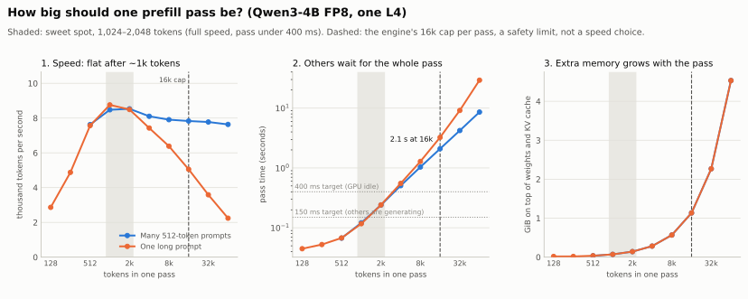

# How big should one prefill pass be?

A **prefill pass** is one trip through the model that reads prompt tokens. The engine limits one pass to 16,384 tokens (16k). Why that number, and what is the best size?

<picture>
  <source media="(prefers-color-scheme: dark)" srcset="../assets/prefill_pass_size/prefill-pass-size-dark.svg">
  
</picture>

## The short answer

- **Best size: about 1,000–2,000 tokens per pass.** That already gives full speed (about 8,500 tokens/s), and each pass stays short (0.12–0.24 s), so other users barely notice it.
- **Bigger passes are not faster.** From 1k to 64k tokens the speed stays about the same, or gets worse for one long prompt.
- **16k is a safety limit, not a speed choice.** At 16k a pass already takes about 2 s, and nobody else gets a token during that time.

## What the three panels show

**1. Speed stops growing after about 1k tokens.**

| Tokens in one pass | 128 | 512 | 1k | 2k | 8k | 16k | 64k |
|---|---|---|---|---|---|---|---|
| Many 512-token prompts | n/a | 7.6k/s | 8.5k/s | 8.5k/s | 7.9k/s | 7.8k/s | 7.6k/s |
| One long prompt | 2.9k/s | 7.6k/s | 8.8k/s | 8.5k/s | 6.4k/s | 5.1k/s | 2.2k/s |

- **Small passes waste the GPU.** At 128 tokens, most of the time is fixed cost (reading the weights, starting kernels).
- **The GPU is full from about 1k tokens.** After that, more tokens just take proportionally longer.
- **One very long prompt gets slower per token,** because attention work grows with length × length. A 64k prompt runs at only 2.2k tokens/s.

**2. Everyone else waits for the whole pass.**
- A 2k pass takes 0.24 s, an 8k pass 1.0 s, a 16k pass 2.1 s, and a 64k pass 8.6 s (29 s for one long prompt).
- The engine aims for 150 ms per step while others are generating, which is about 1k tokens, and 400 ms when the GPU is free, which is about 3k tokens.

**3. Extra memory grows with the pass.** About 70 MB per 1k tokens: 1.1 GiB at 16k, 4.5 GiB at 64k. That memory then can't be used to hold more requests.

## So why 16k?

- **Speed:** there is nothing to gain past about 1k tokens.
- **Waiting:** 16k is already a 2-second freeze for other users.
- **Kernel tuning:** our FP8 kernel is pre-tuned up to 16k rows.
- **Memory:** 1.1 GiB of extra memory is still safe next to a full KV cache.

In practice the engine stays far below 16k. Its step-time targets keep passes at about 600–3,000 tokens, which is the sweet spot shown in the chart.

## How it was measured

```bash
.conda-env/bin/python -m minillm_l4.benchmarks.commands.run_prefill_pass_size --output-dir minillm_l4/results/prefill_pass_size_<date>
.conda-env/bin/python minillm_l4/scripts/make_prefill_pass_charts.py minillm_l4/results/prefill_pass_size_<date>/prefill_pass_size.json minillm_l4/docs/assets/prefill_pass_size
```

- Exactly one prefill pass per run, 128 to 65,536 tokens. Each run warms up once, then takes the median of 3. Qwen3-4B FP8 on one NVIDIA L4, 2026-10-26.
- Each size was run in two ways:
  - **One long prompt,** where attention grows with length × length.
  - **Many 512-token prompts packed into the pass,** which shows the effect of pass size alone.
- **Extra memory** is the peak memory during the pass, minus what was in use before (weights and KV cache).
