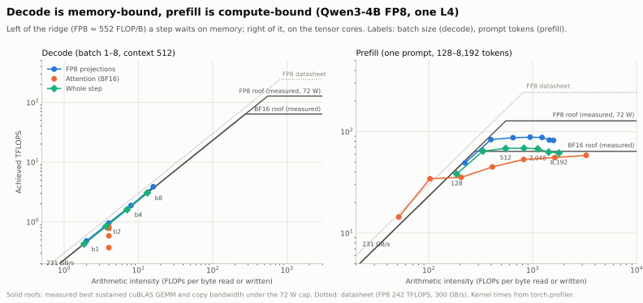
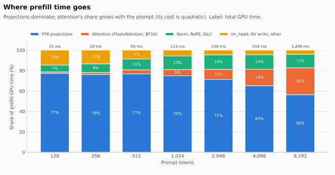

# Q2: Is prefill compute-bound and decode memory-bound?

**Short answer: yes, and the switch happens at about 300 tokens per forward pass.**

- **Decode** (one new token per request) reads all 4.4 GB of weights to do very little math. At batch 1–8 it sits on the memory-bandwidth line. Its speed is set by bytes read, not by the tensor cores.
- **Prefill** (a whole prompt at once) reuses each weight for every prompt token. From about 300 tokens it runs into the compute ceiling. Its speed is set by the tensor cores, capped by the L4's 72 W power limit.

Measured on Qwen3-4B FP8 on one NVIDIA L4, 2026-10-26, with fused kernels and merged projections.

<picture>
  <source media="(prefers-color-scheme: dark)" srcset="../assets/roofline/roofline-dark.svg">
  
</picture>

## How to read the roofline

Every kernel moves bytes and does math. Its **arithmetic intensity** is the ratio: FLOPs per byte moved.

- The **sloped line** is memory bandwidth (231 GB/s, measured). A kernel on the slope is **memory-bound**: it finishes as fast as its bytes arrive.
- The **flat lines** are compute ceilings:
  - FP8: 127 TFLOPS, the best sustained cuBLAS result under the 72 W cap;
  - BF16: 64 TFLOPS.

  A kernel under a flat line is **compute-bound**.
- The **ridge point**, where the two meet, is the intensity needed to keep the tensor cores busy: 127 TFLOPS ÷ 231 GB/s ≈ **552 FLOP/byte for FP8** and ≈ 276 for BF16.
- The dotted line is NVIDIA's datasheet (242 TFLOPS FP8, 300 GB/s). The L4 cannot sustain it at 72 W: under load the SM clock falls to 0.9–1.4 GHz. See [GEMM peak](gemm_peak.md).

Why intensity depends on tokens per forward: an FP8 weight is 1 byte and does 2 FLOPs (a multiply and an add) for each row that uses it. With M rows per forward, the projections reach **≈ 2·M FLOP/byte**. So:
- decode batch 1 is about 2 FLOP/B;
- a 2048-token prefill is about 1,200 FLOP/B (activation traffic keeps it below 2·M).

## Decode: memory-bound

| Batch (context 512) | Graph step | GPU time | Intensity (whole step) | Achieved |
|---|---|---|---|---|
| 1 | 20.3 ms | 19.6 ms | 1.9 FLOP/B | 0.4 TFLOPS |
| 2 | 20.7 ms | 19.9 ms | 3.7 | 0.8 |
| 4 | 21.4 ms | 20.8 ms | 7.1 | 1.6 |
| 8 | 23.3 ms | 21.8 ms | 13.2 | 3.1 |

- **All decode points sit on the bandwidth line**, 42–290× below the ridge. The tensor cores are used at 0.3–2.4% of their power-capped peak. The step is the time to read 3.6 GB of FP8 projections plus the 0.78 GB BF16 `lm_head` (about 18.5 ms), then the KV cache.
- **That is why batching decode is nearly free:** going from batch 1 to batch 8 does 8× the work for +15% time. Projections would stay memory-bound up to batch ~275, where 2·M reaches the ridge.
- **Attention is the exception: batching doesn't help it.** Each cached K/V byte is used by exactly 4 query heads (32 query heads ÷ 8 KV heads), so its intensity is fixed at 4 FLOP/B whatever the batch or context. Its cost grows with batch × context, and only fewer KV bytes (an FP8 KV cache, shorter contexts) make it cheaper. At batch 1 it also runs below the bandwidth line (0.4 TFLOPS against a 0.9 roof): one sequence gives the kernel too little parallel work. Details: [decode breakdown](decode_breakdown.md).

## Prefill: compute-bound past ~300 tokens

| Prompt tokens | TTFT | GPU time | Projections | Attention | Whole step |
|---|---|---|---|---|---|
| 128 | 44 ms | 25 ms | 223 FLOP/B · 49 TF | 52 · 14 TF | 186 · 38 TF |
| 256 | 52 | 29 | 397 · 83 | 103 · 34 | 332 · 64 |
| 512 | 67 | 56 | 647 · 87 | 205 · 35 | 550 · 68 |
| 2,048 | 243 | 239 | 1,231 · 87 | 820 · 53 | 1,121 · 68 |
| 8,192 | 1,287 | 1,290 | 1,589 · 82 | 3,277 · 58 | 1,792 · 62 |

How the step changes with prompt length:
- **128 tokens: still memory-bound.** The projections sit on the slope.
- **256 tokens: at the turn.**
- **512+ tokens: compute-bound.** The projections level off at 82–88 TFLOPS. That is 69% of the FP8 roof: our kernel runs at about 80% of cuBLAS because of its 128×128 block scales and activation quantization. Throughput no longer rises with prompt length.

Attention (FlashAttention, BF16) becomes compute-bound past about 1,000 tokens and approaches the BF16 roof (58 of 64 TFLOPS at 8,192).

<picture>
  <source media="(prefers-color-scheme: dark)" srcset="../assets/roofline/prefill-breakdown-dark.svg">
  
</picture>

- **The projections are 56–77% of prefill time.** Attention grows from 1% to 26% at 8,192 tokens: its FLOPs grow with T², the projections' with T.
- **Norm, RoPE and SiLU are 7–14%.** They are memory-bound elementwise kernels: their bytes grow with the prompt and they do almost no math.
- **Short prompts carry fixed costs.** At 128 tokens, about 20 ms of the 44 ms TTFT is host overhead (eager launches), and 3 ms is the one-row `lm_head`.

## What this means for the engine

1. **Mixed batching works because of this asymmetry.** A prefill chunk of ≥ 512 tokens is compute-bound. Adding decode rows to the same forward costs only their FLOPs (tiny), while they share the weight read the chunk already pays for. Running decode alone instead pays the full 18 ms weight read again. This is why chunked prefill with piggybacked decode (the Sarathi / vLLM approach) beats alternating prefill and decode steps.
2. **Chunk size has a floor.** Below about 256 tokens a prefill chunk falls back onto the bandwidth slope and wastes the weight read. Very small chunks smooth decode latency, but each costs nearly a full step.
3. **Decode speedups come from fewer bytes, not faster math:**
   - an FP8 KV cache (attention bytes ÷ 2);
   - an FP8 `lm_head` (−0.4 GB per step, about −1.5 ms);
   - 4-bit weights;
   - larger batches (the same bytes shared by more tokens).

   Faster GEMM math does nothing for decode.
4. **Prefill speedups come from faster math:**
   - our FP8 GEMM is at 87 of cuBLAS's 127 TFLOPS: the gap is the block scaling;
   - FP8 attention would lift the BF16 ceiling for long prompts.

   Fewer bytes do little for prefill.
5. **The real ceiling is the 72 W power cap.** The datasheet's 242 TFLOPS is out of reach for sustained work on this card.

## Method

- **Command** (about 6 minutes):

  ```bash
  .conda-env/bin/python -m minillm_l4.benchmarks.commands.run_roofline --output-dir minillm_l4/results/roofline_<date>
  .conda-env/bin/python minillm_l4/scripts/make_roofline_charts.py minillm_l4/results/roofline_<date>/roofline.json minillm_l4/docs/assets/roofline
  ```
- **Timing:** prefill TTFT p50 (one request) and decode step p50 (CUDA Graphs, 64 tokens). 1 warm-up and 3 measured runs, before any profiler session.
- **GPU time per category:** `torch.profiler` kernel time, grouped by kernel name. A prefill is one prompt + 1 token run. A decode step is the difference of a (prompt + 17) and a (prompt + 1) run, divided by 16.
- **FLOPs and bytes, counted from the model dimensions:**

  | Category | FLOPs | Bytes |
  |---|---|---|
  | Projections, M rows | 2·M·P (P = 3.63 B FP8 parameters) | weights + scales + BF16 activations in and out |
  | `lm_head`, R rows | 2·R·V·H | 0.78 GB BF16 weights |
  | Prefill attention (causal, T tokens) | 36 · 4 · 32 · 128 · T(T+1)/2 | Q, K, V and O read or written once |
  | Decode attention (batch b, context c) | 36 · 4 · 32 · 128 · b · c | the KV cache, 144 KiB per token |

- **Ceilings:** the measured best sustained GEMMs and copy bandwidth from [`run_gemm_peak`](gemm_peak.md).

## Caveats

- **Byte counts are ideal minimums** (each tensor read once from DRAM). Short-prompt attention lands *above* the bandwidth line: its Q, K and V (about 3 MB per layer at 256 tokens) are still in the L4's 48 MB L2 cache, written there by the projection just before.
- **The whole-step points leave out elementwise traffic** (norms, RoPE, SiLU, residual adds). Real whole-step intensity is a little lower than plotted.
- **Decode is measured at context 512.** Longer contexts add KV bytes at a fixed 4 FLOP/B and pull the whole-step point further down the slope.
- **The FP8 ceiling is cuBLAS with per-tensor scales.** Our block-scaled kernel's practical ceiling is about 100 TFLOPS.
