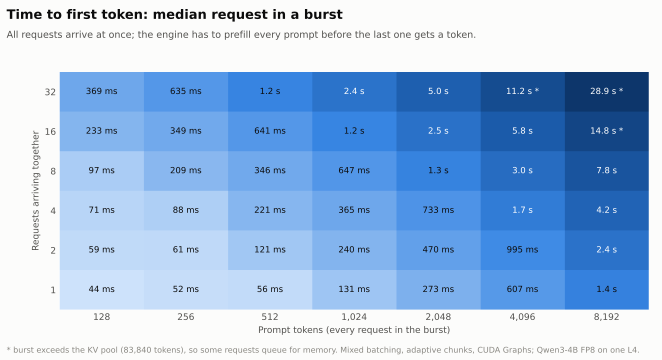
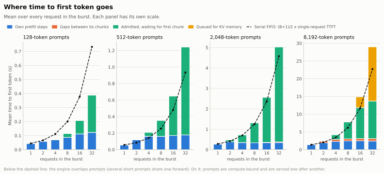
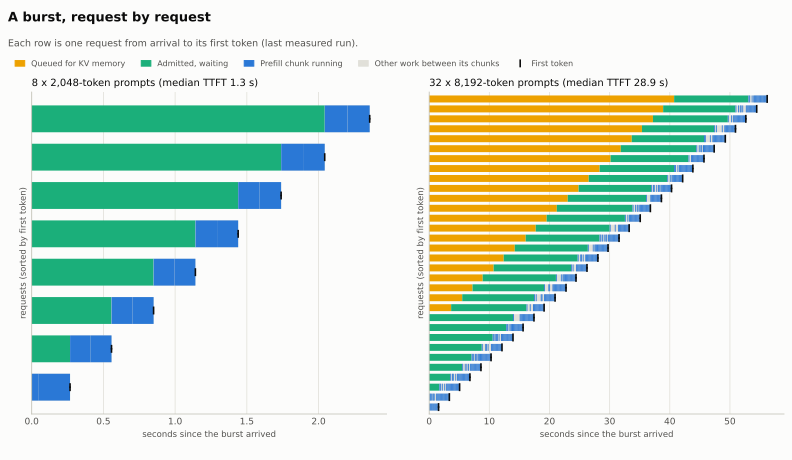

# Q1: What happens between a request arriving and its first token?

**Short answer.**
- **A lone request:** its time to first token (TTFT) is almost entirely the prefill forward pass, 44 ms at 128 tokens and 1.4 s at 8,192. Everything around it (tokenizing, scheduling, admission, sampling) adds under 1%.
- **A burst of requests:** TTFT becomes a queueing problem. The engine prefills prompts at a sustained **6–7k tokens/s**, so a request waits for every prompt ahead of it. The last request in a burst gets its first token after roughly (total prompt tokens in the burst) ÷ 6.5k tokens/s.
- **When the burst's KV cache doesn't fit in memory,** requests also queue for memory. That wait can dwarf everything else: 15 s on average for 32 × 8,192 tokens.

Measured on Qwen3-4B FP8 on one NVIDIA L4, 2026-10-26.

Engine setup: the recommended configuration (mixed batching, adaptive chunks, CUDA Graph decode, fused kernels, merged projections; prefix cache off). The KV pool is sized to free GPU memory: 83,840 tokens, 11.5 GiB.

Workload: B requests arrive together (B = 1 to 32); every prompt has the same length (128 to 8,192 tokens); each request generates 16 tokens. 1 warm-up and 3 measured runs per case.

## The path of one request

```
client ─► tokenize ─► arrival ─► admission ─► prefill chunk(s) ─► first token ─► detokenize ─► client
          0.2–10 ms      queue for KV      wait for a      forward passes   sampled from    ~5 µs
          (CPU)          pages / a slot    prefill slot    over the prompt  the last chunk
```

| Stage | What happens | Lone request | In a burst |
|---|---|---|---|
| Tokenize | Text → token IDs (CPU, HF tokenizer) | 0.2 ms (128 tokens) to 9.8 ms (8,192), about 1.2 µs per token | Same |
| Queue for memory | Wait until KV pages for prompt + output are free | ~0.1 ms | 0 until the burst exceeds the pool, then seconds |
| Wait for first chunk | Admitted, but other prompts' chunks run first | ~0.1 ms | Grows linearly with requests ahead |
| Prefill | Forward passes over the prompt; K/V written into pages | 44 ms → 1.4 s | Similar per request, but shared with other rows |
| Gaps | Steps running other work between this prompt's chunks | 0 | 0.4–0.7 s for 8,192-token prompts |
| First token | Sampled from the last chunk's logits, in the same step | 0 | 0 |
| Detokenize | One token → text | 5–9 µs | Same |

## TTFT across burst size and prompt length

<picture>
  <source media="(prefers-color-scheme: dark)" srcset="../assets/ttft_anatomy/ttft-heatmap-dark.svg">
  
</picture>

- **Down a column (more requests):** median TTFT roughly doubles each time the burst doubles. Each request waits for about half the burst ahead of it.
- **Along a row (longer prompts):** TTFT grows with total prompt tokens.
- **Starred cells** exceed the KV pool, so part of the burst waits for memory.

## Where the time goes

<picture>
  <source media="(prefers-color-scheme: dark)" srcset="../assets/ttft_anatomy/ttft-anatomy-dark.svg">
  
</picture>

The dashed line is a strictly serial queue: each prompt served alone, one after another, so the average request waits (B+1)/2 single-request TTFTs.

1. **Short prompts are packed, and beat the serial line.** At 128 tokens, a lone prefill is memory-bound: most of its 44 ms is fixed cost, mainly the weight read and launches. Several short prompts share one forward and one weight read, so 32 requests average 0.39 s instead of 0.74 s serially (0.53×).
2. **From about 512 tokens, prompts are compute-bound and served one after another.** Mean TTFT tracks (B+1)/2 × single TTFT, 1.05–1.13× the line at 1–4k tokens. Per-request compute stays flat (about 0.35 s at 2,048 tokens whatever the burst). All the growth is waiting: at 32 × 2,048, the average request waits 4.7 s for 0.35 s of its own compute.
3. **One lone prompt runs faster than the sustained rate.** A single 512-token prompt runs at 8.7k tokens/s, but a burst settles at 6.5–7k. Two likely reasons:
   - sustained load runs at the power-capped clock (see [GEMM peak](gemm_peak.md));
   - the planner interleaves decode for requests that already have their first token.

   That is why mid-length bursts sit slightly above the serial line (up to 1.39× at 512 tokens).
4. **Long prompts get chunked, and chunking costs TTFT.** Alone, an 8,192-token prompt runs in about 8 chunks under the 400 ms idle step target. With other requests decoding, the planner switches to the 150 ms busy target: about 17 chunks, plus 0.4–0.7 s of gaps where other work runs. This deliberately trades TTFT for smooth decode latency for the requests already streaming, and it lowers the sustained rate to about 4.7k tokens/s.
5. **Memory is the hard wall.** The pool holds about 10 requests of 8,192 + 16 tokens. At 32 × 8,192, 22 requests must wait for earlier ones to finish and free their pages: the memory queue averages 15.3 s of the 28.9 s median TTFT. 4,096-token bursts hit the same wall at 32 requests (2.4 s).

## A burst, request by request

<picture>
  <source media="(prefers-color-scheme: dark)" srcset="../assets/ttft_anatomy/ttft-timeline-dark.svg">
  
</picture>

- **Left, 8 × 2,048 tokens:** a staircase. Every request is admitted at once (green: waiting), and prompts are prefilled one after another, each in 2–3 chunks (blue).
- **Right, 32 × 8,192 tokens:** the top 22 requests first queue for memory (yellow) until earlier requests finish and free pages. Their prefill is split into many chunks, with other work (light gray) between them.

## Sustained prefill rate

The last request's TTFT ≈ total burst tokens ÷ sustained prefill rate:

| Burst | Total tokens | Last first token | Rate |
|---|---|---|---|
| 32 × 128 | 4,096 | 0.72 s | 5.7k tokens/s |
| 32 × 512 | 16,384 | 2.43 s | 6.7k |
| 32 × 2,048 | 65,536 | 10.0 s | 6.6k |
| 32 × 4,096 | 131,072 | 21.9 s | 6.0k |
| 8 × 8,192 | 65,536 | 14.0 s | 4.7k |

## What this means

- **For one user, TTFT is a kernel problem.** Make prefill faster: our FP8 GEMM runs at about 87 of cuBLAS's 127 TFLOPS ([roofline](roofline.md)), and short prompts carry about 20 ms of fixed host and launch cost.
- **For many users, TTFT is a queueing problem.** TTFT p95 ≈ the work ahead of you ÷ sustained prefill rate. The levers are:
  - raise throughput (faster prefill, more GPUs);
  - avoid redundant work (prefix caching for shared system prompts);
  - schedule: shortest-prompt-first or SLO-aware ordering helps the median, and fair interleaving bounds the worst case;
  - admission control (reject or shed load early instead of queueing for 50 s).
- **The scheduler sets a TTFT vs decode-latency trade-off.** Long prompts chunked under a 150 ms step target keep other users' token streams smooth, but add 0.4–0.7 s to each long prompt's TTFT.
- **KV memory caps how many requests run at once.** Past the pool, extra requests wait for whole requests to finish. A smaller KV footprint (FP8 KV cache, half the bytes) would roughly double the burst that fits.
- **Host work is negligible** at this scale: tokenizing is about 1.2 µs per token, detokenizing one token about 5–9 µs.

## Method

- **Command** (about 20 minutes):

  ```bash
  .conda-env/bin/python -m minillm_l4.benchmarks.commands.run_ttft_anatomy --output-dir minillm_l4/results/ttft_anatomy_<date>
  .conda-env/bin/python minillm_l4/scripts/make_ttft_anatomy_charts.py minillm_l4/results/ttft_anatomy_<date>/ttft_anatomy.json minillm_l4/docs/assets/ttft_anatomy
  ```
- **Components come from each request's recorded events:** arrival, admission, `prefill_chunk_start` / `prefill_chunk_end` for each chunk, and `first_token_ready`.
  - queue = admission − arrival;
  - wait = first chunk − admission;
  - compute = the sum of its chunk steps;
  - gaps = the time from first chunk to last chunk end, minus compute.

  They add up to TTFT exactly.
- **"Compute" is the full duration of each step that carried one of the request's chunks.** Those steps may also carry other requests' chunks or decode rows, so per-request compute in a burst is an upper bound on its own share.
- **KV pool:** free GPU memory after loading, minus 4 GiB of headroom. No allocator retries in any case.
- **Tokenizer costs:** HF tokenizer on CPU, median of 20, measured outside the engine.

## Caveats

- **Burst arrivals are a stress case.** With requests arriving spread over time (a Poisson process), waits are shorter. That is Q15 (latency vs load).
- **All prompts in a burst have the same length,** so "shortest remaining first" has nothing to reorder. Mixed lengths would favor short prompts.
- **No server layer.** There is no HTTP/SSE in this engine; in a real server, request parsing and streaming add their own (small) costs.
